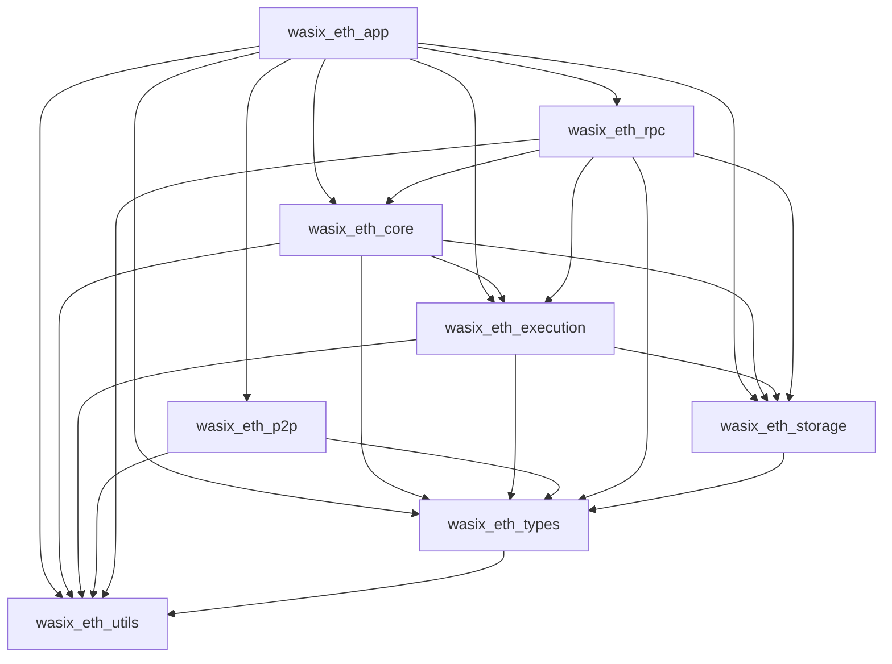
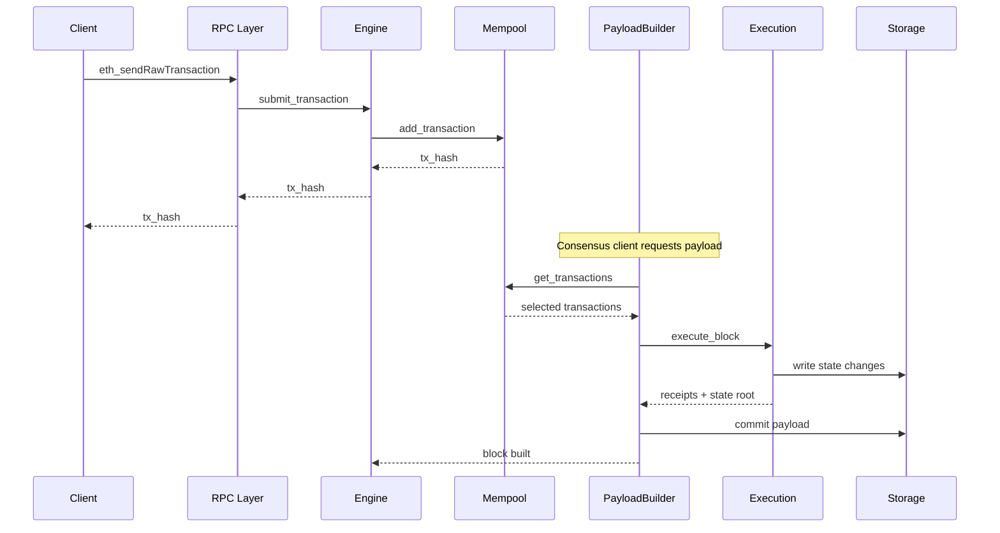
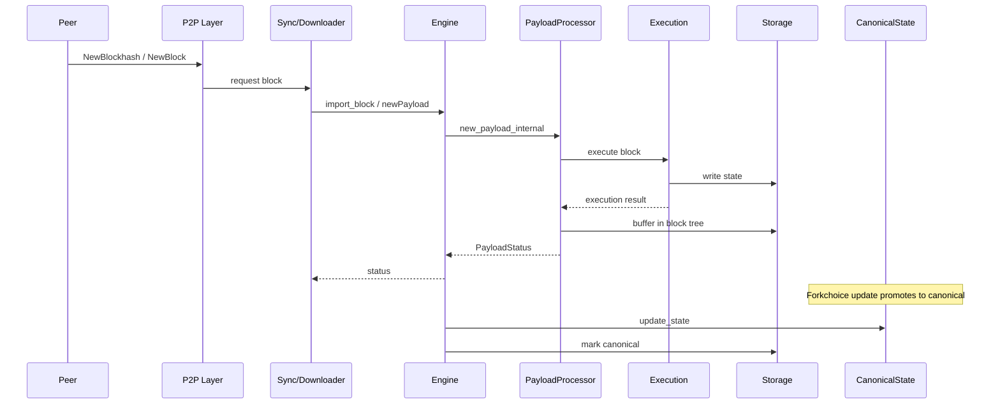

# Architecture

This document provides a deep dive into the internal design of NEXUS (the `wasix_eth` crate), covering the crate structure, layered architecture, data flows, Engine API integration, synchronization, reorg handling, and storage layer.

## Crate Dependency Graph

### Crate Overview

| Crate | Role | Key Dependencies |
|---|---|---|
| `wasix_eth_app` | CLI entry point, node lifecycle management, RPC server setup, bootstrap registry integration | All other crates |
| `wasix_eth_core` | Core protocol: Engine, ChainManager, Mempool, Gossip, Sync | execution, storage, types, utils |
| `wasix_eth_execution` | EVM execution: Executor, Backend, State, block/transaction execution | storage, types, utils |
| `wasix_eth_p2p` | P2P networking: Discv4, RLPx transport, PeerManager, SyncService | types, utils |
| `wasix_eth_rpc` | JSON-RPC server with partially implemented namespaces | core, execution, storage, types, utils |
| `wasix_eth_storage` | Persistent storage via `redb` | types |
| `wasix_eth_types` | Shared types, traits, genesis config, engine types, alloy re-exports | utils |
| `wasix_eth_utils` | Logging, Prometheus metrics, mappers, identity | — |

## Layered Architecture

The node is organized into five layers, each with clear responsibilities:

### 1. Application Layer (`wasix_eth_app`)

The top-level layer that bootstraps the node. Key components:

- **CLI (`cli.rs`)**: Parses command-line arguments via `clap`. Supports subcommands (`run`, `init`, `import`) and common flags (`--data-dir`, `--genesis-path`, `--dev`, `--chain`, `--bootnodes`, `--auth-rpc-jwt-path`, etc.)
- **App (`app.rs`)**: Orchestrates node startup, creating storage, execution, networking, and RPC components
- **Node (`node.rs`)**: Manages the node lifecycle, starting and coordinating all subsystems
- **Bootstrap Registry**: Integrates with the `metrics_server` for auto-registration and peer discovery

### 2. Core Protocol Layer (`wasix_eth_core`)

The heart of the node, containing the protocol logic:

#### Engine (`engine/`)

The `Engine` struct is the central coordinator, implementing the Ethereum Engine API. It contains:

- **`CanonicalState`** — tracks the current forkchoice state (head, safe, finalized block hashes)
- **`BlockTree`** — stores sidechain blocks that are validated but not yet canonical
- **`ReorgHandler`** — manages chain reorganizations, including fast switch and standard revert
- **`PayloadProcessor`** — handles `newPayload` calls: validates blocks, executes them, buffers them in the block tree, and manages state tip
- **`PayloadBuilder`** — handles payload building requests from the consensus client with interruption support
- **`ImportGate`** — gate mechanism to prevent concurrent imports
- **`StateTip`** — tracks the highest block number with committed state
- **`ForkchoiceValidator`** — validates safe and finalized block ancestry during forkchoice updates
- **`RPCEngine`** — RPC-facing engine API implementation

#### Chain Manager (`chain_manager.rs`)

Implements the `ChainManager` trait, providing:

- Block and header lookups
- Canonical chain tracking
- Invalid block tracking with `InvalidationReason` (Soft/Hard)
- Reorg resolution via `resolve_reorg()` which finds common ancestors and identifies new canonical blocks
- Sync status management

#### Mempool (`mempool/`)

Transaction pool management:

- **`Mempool`** — stores pending transactions, validates and scores them
- **`MempoolProvider`** — trait interface for mempool operations
- **`MempoolListener`** — listens for canonical block events and reorgs to remove included transactions and re-add discarded ones
- Blob storage for EIP-4844 transactions

#### Gossip (`gossip/`)

P2P transaction propagation:

- **`GossipBridge`** — bridges between the P2P layer and the mempool
- **`GossipHandler`** — processes incoming gossip transactions

#### Consensus (`consensus.rs`)

Consensus validation logic (`EthConsensus`) implementing the `Consensus` trait for block header validation.

#### Sync (`sync/`)

Chain synchronization subsystem:

- **`SyncOrchestrator`** — background loop that connects `SyncRegistry` to `SyncProvider`, triggering sync when new targets appear
- **`SyncRegistry`** — manages sync targets and notifies the orchestrator
- **`Downloader`** — fetches blocks from peers
- **`Processor`** — processes downloaded blocks through the engine
- **`Controller`** — coordinates the sync workflow

### 3. Execution Layer (`wasix_eth_execution`)

EVM execution powered by the `evm` crate:

- **`Executor`** — executes individual transactions
- **`Backend`** — provides the EVM backend with state access
- **`State`** — manages account and storage state during execution
- **`execution_provider`** — `ExecutionProvider` trait and `EthExecutionProvider` implementation for block-level execution
- **`config`** — EVM configuration for different hardforks
- **`transaction`** — transaction execution logic
- **`block`** — block execution logic with batch support

### 4. Storage Layer (`wasix_eth_storage`)

Persistent storage backed by `redb` (a key-value embeddable database):

- **`EthDatabase`** — database wrapper with table initialization and genesis setup
- **`DatabaseReadProvider`** — read operations with provider traits
- **`DatabaseWriteProvider`** — write operations with provider traits and batch support
- **`codecs`** — serialization/deserialization for table entries
- **`tables`** — table definitions (see below)
- **`trie`** — Merkle Patricia Trie implementation for state root calculation
- **`REORG_LIMIT`** — constant (100) controlling how many blocks of state history are kept for reorg recovery

### 5. Networking Layer (`wasix_eth_p2p`)

P2P communication stack:

- **Discv4** — node discovery protocol
- **RLPx transport** — encrypted transport with ECIES handshake, framing, and encryption
- **`PeerManager`** — manages peer connections, registry, and dialer
- **`SyncService`** — P2P-side of block synchronization

### 6. RPC Layer (`wasix_eth_rpc`)

JSON-RPC server via `jsonrpsee`:

- **`RpcServerFacade`** — aggregates all namespace handlers
- **Namespaces**: `eth_*`, `engine_*`, `admin_*`, `net_*`, `web3_*`, `debug_*`
- **JWT authentication** for the Engine API endpoint

## Data Flows

### Transaction Flow: RPC → Mempool → Block Production → Storage

### Block Flow: P2P Arrival → Validation → Execution → Canonical Chain

### Engine API Integration with Consensus Clients

The Engine API is the bridge between the execution client (wasix_eth) and the consensus client (e.g., Lighthouse). The flow:

1. **`engine_newPayloadV3/V4`**: The consensus client sends a newly attested block. The `PayloadProcessor` validates the block, executes it, and stores it in the `BlockTree` (sidechain) or directly in storage if it extends the canonical head.

2. **`engine_forkchoiceUpdatedV3/V4`**: The consensus client signals which block should be the head. The Engine:
   - Validates the head block status (Valid/Syncing/Invalid)
   - Checks safe and finalized block ancestry
   - Resolves any reorgs between the old and new head
   - Promotes new canonical blocks (synchronously for shallow reorgs, asynchronously for deep reorgs)
   - Optionally starts building a new payload if `PayloadAttributes` are provided

3. **`engine_getPayloadV3/V4`**: The consensus client retrieves a built payload for proposal.

4. **`engine_exchangeTransitionConfigurationV1`**: Exchanges the merge transition configuration.

## Synchronization Mechanisms

### Sync Registry

The `SyncRegistry` tracks sync targets (block hashes and heights that the node needs to fetch). When a new target is added, it notifies the `SyncOrchestrator`.

### Sync Orchestrator

Runs as a background task. On notification, it evaluates whether sync is needed and triggers the `SyncProvider` (implemented by `Engine`).

### Downloader

Fetches blocks from peers via the P2P layer. It requests block bodies and headers by hash or range.

### Processor

Processes downloaded blocks by passing them through `Engine::import_block()`, which delegates to `new_payload_internal()` for validation and execution.

## Reorg Handling

Reorgs are managed by the `ReorgHandler` with two strategies:

### Fast Switch

If a persisted `StateRoot` exists for the new head block hash, the node can instantly switch to the new branch without re-execution. This is the fastest path.

### Standard Revert

If fast switch is not possible:
1. Find the common ancestor between the old and new head
2. Revert state to the common ancestor height using `AccountChangeSets` and `StorageChangeSets`
3. Re-execute the new canonical blocks from the common ancestor
4. Update the mempool: remove transactions from the new canonical blocks, re-add transactions from the discarded blocks

### Reorg Detection

During `forkchoice_updated`, the `ChainManager::resolve_reorg()` method:
1. Traces ancestry from both old and new heads
2. Finds the common ancestor
3. Returns a `ReorgContext` with `is_reorg`, `common_ancestor_hash`, and `new_canonical_blocks`

### Shallow vs Deep Reorgs

- **Shallow reorgs** (≤3 blocks or all blocks already in storage): processed synchronously, returning `VALID` immediately
- **Deep reorgs**: processed in a background task, returning `SYNCING` to the consensus client

## Storage Layer Design

### Database Tables

The `redb` database contains these tables:

#### Chain Data
| Table | Purpose |
|---|---|
| `Headers` | Block headers keyed by hash |
| `HeaderTD` | Total difficulty per block hash |
| `BlockBodies` | Transaction hashes, ommers, withdrawals per block |
| `Transactions` | Full transaction data indexed by block and index |
| `Receipts` | Transaction receipts |
| `ReceiptsMeta` | Receipt metadata (cumulative gas, log indices) |

#### Chain Indexes
| Table | Purpose |
|---|---|
| `CanonicalHeads` | Block number → canonical block hash mapping |
| `HeaderNumbers` | Block hash → block number mapping |
| `TransactionLookup` | Transaction hash → (block hash, index) mapping |

#### State
| Table | Purpose |
|---|---|
| `Accounts` | Account state (nonce, balance, storage root, code hash) |
| `Storages` | Storage slot values per account |
| `Bytecodes` | Contract bytecode keyed by code hash |

#### State Changes (for reorgs)
| Table | Purpose |
|---|---|
| `AccountChangeSets` | Account state changes per block for revert |
| `StorageChangeSets` | Storage slot changes per block for revert |

#### State Indexes
| Table | Purpose |
|---|---|
| `TrieNodes` | Merkle Patricia Trie nodes |
| `TrieNodeRefs` | Trie node references for efficient lookup |

#### Metadata
| Table | Purpose |
|---|---|
| `Metadata` | Key-value store for chain_id, genesis_hash, chain_config |

#### Engine
| Table | Purpose |
|---|---|
| `Payloads` | Built payloads keyed by PayloadId and block hash |
| `Forkchoice` | Current forkchoice state (head, safe, finalized) |
| `StateBranches` | State roots for sidechain blocks (enables fast switch) |

#### P2P
| Table | Purpose |
|---|---|
| `ActivePeers` | Peer ENRs for discovery |

### Codecs

The `codecs.rs` module defines serialization/deserialization logic for each table, converting between Rust types and `redb`'s byte format.

### Read/Write Providers

- **`DatabaseReadProvider`**: Implements read traits (`BlockProvider`, `HeaderProvider`, `StateBranchProvider`, `ChainProvider`, `MetadataProvider`) for querying the database
- **`DatabaseWriteProvider`**: Implements write traits (`HeaderWriter`, `BlockWriter`, `AccountWriter`, `StorageWriter`, `BytecodeWriter`, `MetadataWriter`) with batch transaction support for atomic state updates

### Trie Implementation

The `trie.rs` module implements Merkle Patricia Trie operations for state root and storage root calculation, used during genesis initialization and state changes.

### Genesis Initialization

`EthDatabase::init_genesis()` processes the genesis configuration:
1. Iterates over allocations, writing accounts, storage, and bytecodes
2. Calculates the state root from the trie
3. Builds and persists the genesis block header and body
4. Sets metadata (chain_id, genesis_hash, chain_config)

### REORG_LIMIT

The `REORG_LIMIT` constant (100) determines how many blocks of historical state data (change sets, trie nodes, state branches) are retained. Older data is pruned during `forkchoice_updated` to manage storage growth.
